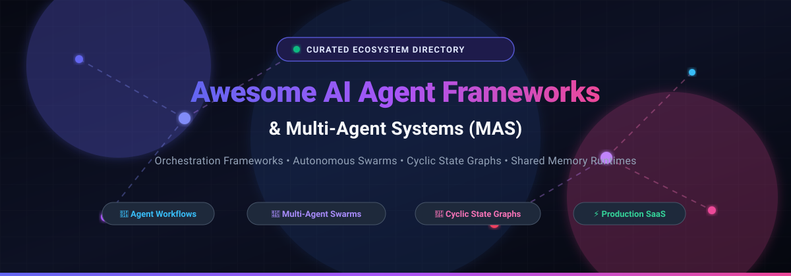
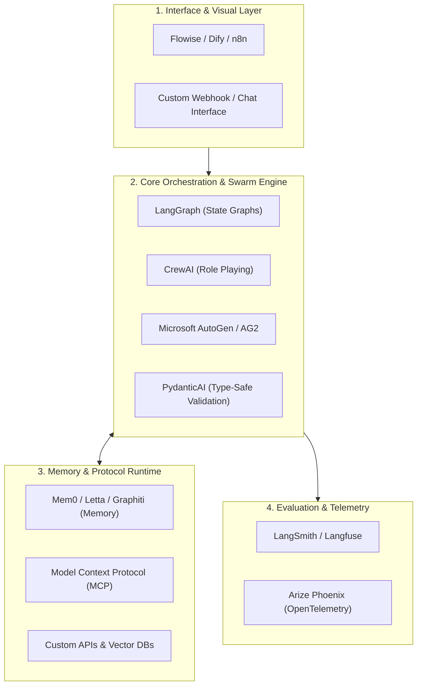

  

  
  
  
  
  
  
  

# 🤖 Awesome AI Agent Frameworks & Multi-Agent Systems (MAS) 🌐

Welcome to the definitive, curated directory of **AI Agent Frameworks**, **Multi-Agent Systems (MAS)**, **Autonomous Swarms**, and **Agentic Workflow Orchestrators**. Whether you are building self-reflective code generation swarms, stateful graph architectures, or deploying enterprise-grade multi-agent SaaS solutions, this collection tracks the best open-source and hosted solutions in the AI ecosystem.

> 🚀 **Explore the Frontier of Autonomous Intelligence**: Multi-agent collaboration, cyclic state graphs, hierarchical memory, tool handoffs, and real-time trace telemetry.

---

## 📑 Table of Contents

- [📊 Sector Overview & Market Dynamics](#-sector-overview--market-dynamics)
- [☁️ SaaS & Hosted Enterprise Platforms](#️-saas--hosted-enterprise-platforms)
- [🛠️ Open-Source GitHub Projects (Ranked by Stars)](#️-open-source-github-projects-ranked-by-stars)
- [🧩 Architecture & Component Stacks](#-architecture--component-stacks)
- [🤝 How to Contribute](#-how-to-contribute)
- [💖 Support & Sponsorship](#-support--sponsorship)
- [⭐ Star History](#-star-history)
- [📜 Disclaimer](#-disclaimer)

---

## 📊 Sector Overview & Market Dynamics

The global **AI Agent** and **Agentic AI** market size is estimated at approximately **$7.84 billion in 2025** and is forecasted to surge to **$52.62 billion by 2030**, reflecting a blistering Compound Annual Growth Rate (**CAGR of 46.3%** per *MarketsandMarkets*). Broad enterprise software expenditures influenced by agentic AI workflows and autonomous decisioning are expected to reach up to **$985 billion by 2030** (*Gartner*).

The ecosystem is currently **moderately to highly fragmented**—characterized by fierce, rapid innovation across orchestration layers, memory runtimes, voice gateways, and low-code builders. Rather than an entrenched winner-take-all monopoly, the market is undergoing swift strategic consolidation through high-profile tech acquisitions (e.g., Asana acquiring Stack AI, Workday acquiring Flowise, Inworld acquiring Fixie/Ultravox), while foundational open-source protocols continue to democratize multi-agent coordination.

---

## ☁️ SaaS & Hosted Enterprise Platforms

The table below catalogs premier commercial and hosted agent orchestration platforms, ranked in descending order by company size and enterprise traction.

| Platform | Description | Estimated Size (Valuation / Scale) | Pricing (Starting Paid Tier) | Free Tier / Trial Limits |
| :--- | :--- | :--- | :--- | :--- |
| **[LangGraph Platform](https://langchain.com)** | Managed cloud infrastructure for deploying, scaling, and debugging stateful cyclic multi-agent graphs with LangSmith integration. | **$3.0B** (Series C valuation; ~$460M total raised) | **$39 / user / month** (Plus tier; includes 1 small serverless agent server & 10,000 monthly traces) | **Free tier forever**: 1 user seat, 5,000 base traces/month, 14-day data retention, up to 100k local node runs |
| **[Dify Cloud](https://dify.ai)** | Hosted LLM app and agentic workflow platform combining visual orchestration, RAG pipelines, model routing, and API publishing. | **$180M** (Series Pre-A valuation; ~$30M raised) | **$59 / month** (Professional tier; includes 5,000 messages/mo, 50 apps, 3 team members) | **Free tier forever** (Sandbox plan): 1 member, 5 apps, 200 one-time message credits, 50 MB / 50 docs storage |
| **[Botpress Cloud](https://botpress.com)** | Enterprise conversational AI and autonomous agent studio with visual flow building, knowledge base sync, and omnichannel deployment. | **$120M** (Series B valuation; ~$40M+ raised, ~$10M+ ARR) | **$150 / month** (Plus tier billed annually / $189 monthly; includes 250 conversations/mo & $25 AI credits) | **Free tier forever**: 3 workspace seats, up to 3 AI agents, up to 100 conversations/month (hard capped) |
| **[CrewAI Enterprise](https://crewai.com)** | Cloud-hosted multi-agent orchestration platform featuring visual crew and flow builders, RBAC, tracing, and managed deployments. | **$76M–$93M** (Estimated valuation; $18M Series A, ~$2.4M–$3.2M ARR) | **$25 / month** (Starting paid tier / Pro via marketplace; Custom Enterprise at $60,000+/yr) | **Free tier forever** (Basic plan): Visual editor & copilot, 50 workflow executions/month, 2 automations |
| **[Stack AI](https://stack-ai.com)** | Enterprise AI workflow and multi-agent automation platform with SOC2/HIPAA compliance and pre-built business connectors. | **$75M** (Acquired by Asana; previously $64M valuation, ~$20M raised) | **Custom Enterprise** (Self-serve paid tiers retired post-acquisition; contact sales for pricing) | **Free tier forever**: 1 user seat, 2 projects, 500 workflow runs/month, Discord community support |
| **[Letta Cloud](https://letta.com)** | Hosted stateful agent runtime built on MemGPT principles for long-term hierarchical memory and multi-session context. | **$70M** (Seed valuation; $10M raised, ~$1.4M ARR) | **$20 / month** (Pro plan; includes up to 20 stateful agents and monthly credit allowance) | **Free tier forever**: Up to 3 stateful agents, 5 MiB storage per memory repository (BYO LLM API keys) |
| **[SuperAGI Cloud](https://superagi.com)** | Cloud-based autonomous agent platform for concurrent agent runs, marketplace toolkits, and trajectory performance telemetry. | **~$60M–$75M** ("Sub-$100M" Series A valuation; ~$15M raised, ~$9.9M ARR) | **$19 / month** (Starting paid starter tier; credit-based usage for multi-agent workflows) | **Free tier forever**: Basic cloud agent access, community tools, Bring-Your-Own-Key (BYOK) execution |
| **[Fixie.ai](https://fixie.ai)** | Speech-native voice AI and conversational agent runtime platform (operating as Ultravox). | **$51.5M** (Seed valuation; $17M raised, acquired by Inworld AI) | **$100 / month** (Pro plan; uncapped concurrency, outbound scheduler, 5 voice clones, 20 RAG corpora) | **Free tier forever** (Pay-as-you-go starter): 30 free call minutes, max 5 concurrent calls, unlimited playground testing |
| **[Relevance AI](https://relevanceai.com)** | Low-code cloud workforce platform for building, chaining, and scheduling teams of autonomous AI agents across business operations. | **~$50M+** (Est. valuation; ~$37M–$42M raised across Series A/B, ~$2.5M+ ARR) | **$29 / month** (Pro plan billed monthly / $19 monthly billed annually; includes 2,500 Actions & 2 builders) | **7-day free trial** with annual subscription toggle (permanent free plan retired; limited trial credits) |
| **[Flowise Cloud](https://flowiseai.com)** | Managed visual drag-and-drop platform for building and deploying multi-agent workflows and tool-calling assistants via APIs. | **~$10M–$20M** (Acquired by Workday; previously raised seed round, ~$1M ARR) | **$35 / month** (Starter plan; includes unlimited flows, ~10,000 predictions/month, 1 GB storage) | **Free tier forever**: 2 flows & assistants, 100 predictions/month, 5 MB storage, community support |

---

## 🛠️ Open-Source GitHub Projects (Ranked by Stars)

All open-source frameworks below are arranged in **strict descending order by real-time GitHub Star count**. Each repository includes an official live social star badge linking directly to its stargazers page.

1. **[n8n](https://github.com/n8n-io/n8n)**   
   ⚡ Fair-code workflow automation platform with native AI agent nodes, multi-agent LangChain integrations, human-in-the-loop approvals, and 400+ pre-built enterprise connectors.

2. **[AutoGPT](https://github.com/Significant-Gravitas/AutoGPT)**   
   🧠 Pioneering autonomous open-source agent framework and ecosystem offering modular agent blocks, continuous execution loops, and a rich library of agent skills.

3. **[Dify](https://github.com/langgenius/dify)**   
   🚀 Production-grade open-source LLM application and agentic workflow platform combining visual prompt orchestration, RAG pipelines, and multi-model routing.

4. **[MetaGPT](https://github.com/FoundationAgents/MetaGPT)**   
   🏢 Multi-agent meta-programming framework that encodes Standard Operating Procedures (SOPs) into specialized agents acting as product managers, architects, and engineers.

5. **[Mem0](https://github.com/mem0ai/mem0)**   
   💾 Universal memory layer for personalized AI agents, providing long-term adaptive memory across multiple user sessions and agentic swarms.

6. **[Microsoft AutoGen](https://github.com/microsoft/autogen)**   
   💬 Comprehensive multi-agent conversation framework and low-code AutoGen Studio for building event-driven, asynchronous multi-actor conversational systems.

7. **[CrewAI](https://github.com/crewAIInc/crewAI)**   
   👥 Popular Python framework for orchestrating collaborative teams of role-playing autonomous AI agents and structured deterministic Flows.

8. **[Flowise](https://github.com/FlowiseAI/Flowise)**   
   🎨 Open-source drag-and-drop visual UI builder for orchestrating LLMs, multi-agent swarms (`Agentflows`), vector databases, and custom tool-calling chains.

9. **[LlamaIndex Workflows](https://github.com/run-llama/llama_index)**   
   📚 Event-driven orchestration framework engineered for multi-agent handoffs, complex document indexing, and advanced multi-step RAG pipelines.

10. **[LangGraph](https://github.com/langchain-ai/langgraph)**   
    🔄 Resilient, stateful, multi-actor orchestration framework modeling complex agent interactions as cyclic computation graphs with human-in-the-loop interrupts.

11. **[Agno (formerly Phidata)](https://github.com/agno-agi/agno)**   
    ⚡ High-performance multi-modal agent framework and runtime featuring shared agent memory, embedded knowledge bases, and structured deterministic workflows.

12. **[Langfuse](https://github.com/langfuse/langfuse)**   
    🔍 Open-source LLM engineering platform offering production observability, metrics, evaluations, and deep nested tracing for complex multi-agent execution trees.

13. **[AgentScope (Alibaba)](https://github.com/agentscope-ai/agentscope)**   
    🌐 Distributed multi-agent programming platform featuring actor-based message passing, fault-tolerant execution, and web-based visual monitoring.

14. **[ChatDev (OpenBMB)](https://github.com/OpenBMB/ChatDev)**   
    💻 Virtual multi-agent software development company where communicative agents collaborate across software design, coding, testing, and documentation phases.

15. **[Graphiti (Zep)](https://github.com/getzep/graphiti)**   
    🕸️ Dynamic knowledge graph memory engine purpose-built for AI agents to continuously ingest, organize, and query episodic and temporal relationships.

16. **[Mastra](https://github.com/mastra-ai/mastra)**   
    ⚛️ Modern TypeScript multi-agent framework featuring graph workflows, shared state memory, automated evals, and first-class Next.js/React integration.

17. **[Semantic Kernel (Microsoft)](https://github.com/microsoft/semantic-kernel)**   
    🔧 Enterprise-grade SDK from Microsoft orchestrating AI agents, plugins, and planners across C#/.NET, Python, and Java enterprise ecosystems.

18. **[Letta (formerly MemGPT)](https://github.com/letta-ai/letta)**   
    🧠 Stateful agent runtime equipping LLMs with self-editing hierarchical memory, long-term persistence, and multi-agent message routing.

19. **[Google Agent Development Kit (ADK)](https://github.com/google/adk-python)**   
    🧪 Google's flexible code-first toolkit for designing, evaluating, and deploying modular multi-agent hierarchies with bidirectional streaming support.

20. **[OpenAI Swarm & Agents SDK](https://github.com/openai/swarm)**   
    🐝 Lightweight educational Python runtime showcasing ergonomic multi-agent coordination, explicit agent handoffs, and routine execution patterns.

21. **[PydanticAI](https://github.com/pydantic/pydantic-ai)**   
    🛡️ Type-safe Python agent framework engineered by Pydantic for strictly validated structured outputs, agent delegation, and production-grade reliability.

22. **[ElizaOS (ai16z)](https://github.com/elizaOS/eliza)**   
    🎭 Flexible TypeScript multi-agent OS designed for autonomous persona creation, multi-platform social interactions, and modular skill plugins.

23. **[CAMEL-AI](https://github.com/camel-ai/camel)**   
    🐫 First communicative agent framework dedicated to autonomous agent society exploration, scalable role-playing, and synthetic data generation.

24. **[SuperAGI](https://github.com/TransformerOptimus/SuperAGI)**   
    🤖 Developer-first autonomous agent infrastructure featuring concurrent agent spawning, graphical trajectory visualizers, and tool marketplaces.

25. **[Botpress](https://github.com/botpress/botpress)**   
    💬 Open-source conversational infrastructure and developer platform for deploying multi-channel conversational agents and custom toolchains.

26. **[Arize Phoenix](https://github.com/Arize-ai/phoenix)**   
    🔥 AI observability and evaluation platform providing OpenTelemetry-based distributed tracing for multi-agent interactions and RAG debugging.

27. **[Atomic Agents](https://github.com/Eigenwise/atomic-agents)**   
    ⚛️ Minimalist, Pydantic-first multi-agent framework built on composable atomic agent primitives, structured schema validation, and deterministic pipelines.

28. **[AG2 (formerly AutoGen Community)](https://github.com/ag2ai/ag2)**   
    🤝 Community-driven multi-agent framework continuing classic `pyautogen` architecture with nested group chats, swarms, and human-in-the-loop controls.

---

## 🧩 Architecture & Component Stacks

When architecting a production-grade multi-agent application, successful engineering teams typically integrate a 4-pillar modular stack:

---

## 🤝 How to Contribute

We welcome additions, corrections, and updates from the developer and research community!

1. 🍴 **Fork the repository**.
2. 📝 **Add or update an entry** in `README.md`:
   - Keep entries strictly alphabetical or in their respective sorted rank.
   - Include the project name, official repository/product link, and a concise 1–2 sentence description.
   - For SaaS products, provide starting price tiers and free limits.
   - For open-source projects, include the social GitHub stars badge linking to its stargazers page.
3. 🚀 **Submit a Pull Request** with a descriptive summary of your changes.

---

## 💖 Support & Sponsorship

If you find this ecosystem directory helpful for your research, company, or personal projects, please consider showing your support:

- ⭐ **Star this repository** to help others discover it on GitHub!
- 🍴 **Fork and share** with fellow developers and AI builders.
- ☕ **Sponsor the maintainer** or buy a coffee via the [GitHub Sponsor Dashboard](https://github.com/sponsors/ishandutta2007).

Thank you to all contributors and the open-source community for driving the future of agentic intelligence! 🙌

---

## ⭐ Star History

---

## 📜 Disclaimer

*This list is actively curated for educational, technical, and informational purposes. Project descriptions, market valuations, and pricing tiers reflect publicly accessible information and community benchmarks as of November 2026. Trademarks belong to their respective creators.*
